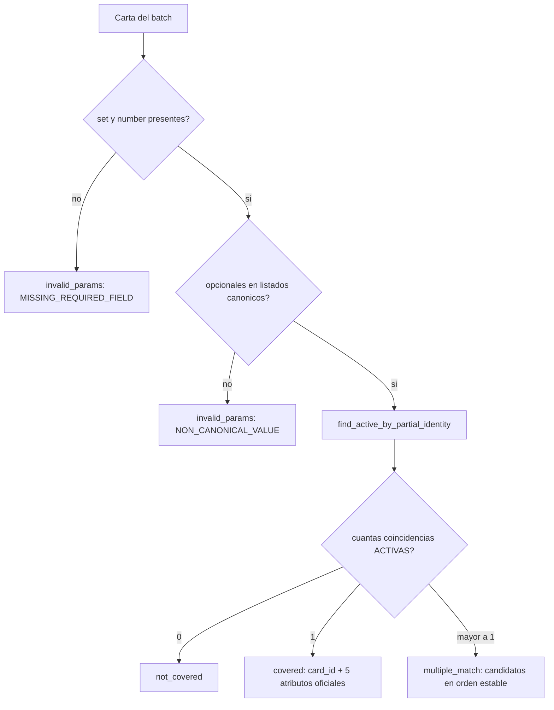
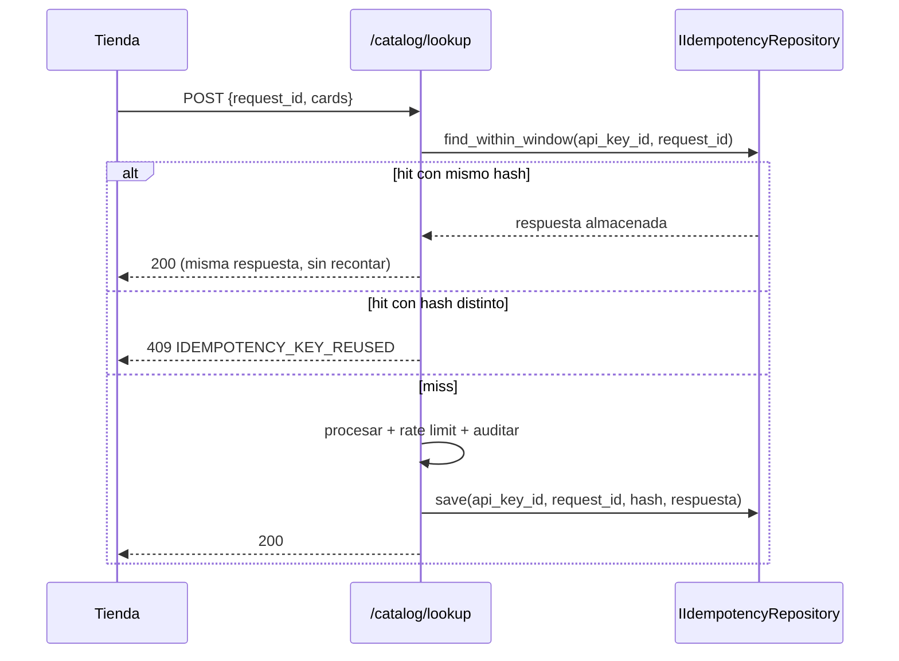

# ADR-004 — Diseño del API B2B de cobertura de catálogo (US-005)

**Estado:** Aceptado
**Fecha:** 2026-06-13
**Autores:** Equipo Dr. Mundo Solutions
**Sprint:** 3
**Historia de usuario:** US-005 — Consultar cobertura de catálogo por API B2B (lookup de carta)

---

## Contexto

Las tiendas (Customers B2B) que revenden cartas Pokémon quieren saber, **antes** de enviar una carta a evaluación, si esa carta existe en el catálogo de PokéGrading. Enviar una carta que el catálogo no reconoce desperdicia su cuota de evaluación.

Se necesita un API **máquina-a-máquina** (no para humanos en un navegador) que:

1. Autentique a la tienda mediante una **API key** (no JWT de usuario — son sistemas, no personas).
2. Reciba **solo los datos de identidad** de una o varias cartas (nunca imágenes) y responda, por cada carta, si está **cubierta**, tiene **coincidencia múltiple**, **no está cubierta** o tiene **parámetros inválidos**.
3. Sea **de solo lectura**: nunca descuente cuota de evaluación ni dispare el motor de grading.
4. Sea **seguro, versionado, auditable e idempotente**, con un **formato de error único**.

Este ADR define el contrato, los estados de resultado, el manejo de errores, la idempotencia, el rate limiting, la validación condicional (ETag), el logging y el esquema de almacenamiento. La estructura de llaves, periodos de gracia y revocación se detallan en el documento hermano [`diseno-versionamiento-seguridad-api.md`](./diseno-versionamiento-seguridad-api.md). El tratamiento de datos sensibles en [`diseno-datos-sensibles.md`](./diseno-datos-sensibles.md).

---

## Decisión

Se implementa el API B2B como una **superficie HTTP versionada de forma independiente** (`/api/b2b/v1`), separada del API interno de usuarios (`/api/v2`), siguiendo la misma Clean Architecture del resto del sistema:

```
HTTP  POST /api/b2b/v1/catalog/lookup
  │   header  X-API-Key: pkg_live_<prefix>_<secret>
  │   header  Idempotency-Key: <request_id>        (opcional)
  │   header  If-None-Match: "<etag>"              (opcional)
  ▼
api/b2b/v1/routers/lookup.py
  │   get_current_b2b_client  (dependencia de autenticación)
  ▼
application/use_cases/authenticate_b2b_client.py   → valida llave + customer
application/use_cases/lookup_catalog_coverage.py   → resuelve cada carta
  │   ICardRepository.find_active_by_partial_identity(...)
  │   IRateLimiter.check_and_consume(...)
  │   IIdempotencyRepository / IB2BAuditRepository
  ▼
PostgreSQL (catalog_cards + tablas B2B)
```

**El dominio nunca importa FastAPI ni SQLAlchemy** (Repository pattern, igual que [`decisiones-diseno.md`](../../Sprint2/DOC/decisiones-diseno.md) §1).

---

## 1. Contrato del endpoint

### 1.1 Request

```
POST /api/b2b/v1/catalog/lookup
Host: api.pokegrading.com
Content-Type: application/json
X-API-Key: pkg_live_a1b2c3d4_Zk9...        (requerido)
Idempotency-Key: 5f3c8b10-...              (opcional — también aceptado en body.request_id)
If-None-Match: "cat-v2026061301"           (opcional — validación condicional)

{
  "request_id": "5f3c8b10-...",            // opcional; si está en header y body, gana el header
  "cards": [
    { "set": "Vivid Voltage", "number": "025/185" },
    { "set": "Base Set", "number": "58/102", "edition": "1st Edition",
      "language": "en", "finish": "holo" },
    { "set": "", "number": "4" }           // → invalid_params (falta set)
  ]
}
```

| Campo | Oblig. | Descripción |
|---|---|---|
| `cards` | sí | Lista de 1..N cartas. Lista vacía → `EMPTY_QUERY` |
| `cards[].set` | sí | Nombre del set (obligatorio) |
| `cards[].number` | sí | Número dentro del set (obligatorio) |
| `cards[].edition` | no | Debe pertenecer al listado canónico si se envía |
| `cards[].language` | no | Listado canónico (`en, ja, es, fr, de, it, pt, ko, zh, pl, nl, th`) |
| `cards[].finish` | no | Listado canónico de acabados |
| `request_id` | no | Identificador propio de la tienda para idempotencia |

> Límite duro: `len(cards) ≤ 100` por consulta (configurable). Supera → `MALFORMED_QUERY`.

### 1.2 Respuesta exitosa (`200 OK`)

```
HTTP/1.1 200 OK
Content-Type: application/json
ETag: "cat-v2026061301"
X-Trace-Id: 9b2e...

{
  "request_id": "5f3c8b10-...",
  "etag": "cat-v2026061301",
  "summary": { "total": 3, "covered": 1, "multiple_match": 1, "not_covered": 0, "invalid_params": 1 },
  "results": [
    {
      "index": 0,
      "status": "covered",
      "query": { "set": "Vivid Voltage", "number": "025/185" },
      "card": {
        "card_id": "06a1bdeb-...",
        "set": "Vivid Voltage", "number": "025/185",
        "edition": "Unlimited", "language": "en", "finish": "holo"
      }
    },
    {
      "index": 1,
      "status": "multiple_match",
      "query": { "set": "Base Set", "number": "58/102", "edition": "1st Edition",
                 "language": "en", "finish": "holo" },
      "candidates": [
        { "card_id": "0a..", "set": "Base Set", "number": "58/102",
          "edition": "1st Edition", "language": "en", "finish": "holo" },
        { "card_id": "0b..", "set": "Base Set", "number": "58/102",
          "edition": "1st Edition", "language": "en", "finish": "reverse holo" }
      ]
    },
    {
      "index": 2,
      "status": "invalid_params",
      "query": { "set": "", "number": "4" },
      "reason": { "code": "MISSING_REQUIRED_FIELD", "field": "set",
                  "message": "El campo 'set' es obligatorio." }
    }
  ]
}
```

> **Aislamiento (AC-12):** el objeto `card`/`candidates` solo contiene `card_id` + los 5 atributos de identidad oficiales. **Nunca** se exponen campos de `submissions`, evaluaciones, ni datos de otras tiendas.

### 1.3 Respuesta condicional (`304 Not Modified`)

Si la tienda envía `If-None-Match: "<etag>"` y el catálogo no cambió desde ese ETag:

```
HTTP/1.1 304 Not Modified
ETag: "cat-v2026061301"
X-Trace-Id: 9b2e...
(sin cuerpo)
```

El `304` **no descuenta rate limit** (no se reprocesa ninguna carta). Ver §5.

---

## 2. Estados de resultado por carta

La resolución de cada carta es **independiente** (una carta inválida no afecta a las demás del batch — AC-05).



| Estado | Regla |
|---|---|
| `covered` | Exactamente 1 carta con `status = active` coincide. Devuelve los atributos **oficiales del catálogo** (pueden diferir de lo enviado por la tienda). |
| `multiple_match` | > 1 carta activa coincide (típicamente porque la tienda omitió opcionales que desambiguan). Orden **estable y reproducible**: `ORDER BY id ASC` (UUID v7 ⇒ orden cronológico de alta determinista). |
| `not_covered` | 0 coincidencias activas. **Una carta retirada cuenta como `not_covered`** (las cubiertas son siempre activas — AC-04). |
| `invalid_params` | Falta `set`/`number`, o un opcional fuera de listado canónico. Devuelve `reason` con `code`, `field`, `message`. |

---

## 3. Idempotencia

**Objetivo (AC-08):** dos consultas con el mismo `request_id` dentro de una ventana son la misma operación lógica.

| Aspecto | Decisión |
|---|---|
| Identificador | `request_id` (header `Idempotency-Key` o `body.request_id`), por **API key** |
| Ventana | 24 h (configurable `B2B_IDEMPOTENCY_WINDOW_HOURS`) |
| Clave de almacenamiento | `(api_key_id, request_id)` |
| Huella del request | `request_hash = sha256(canonical_json(cards))` |
| Respuesta almacenada | Cuerpo JSON exacto de la primera respuesta |

Reglas:
- **Hit** (misma `(api_key_id, request_id)` dentro de ventana): se devuelve la **respuesta almacenada idéntica**, **no** se recuenta rate limit, **no** se reaudita, **no** se reprocesa el catálogo.
- **Conflicto** (mismo `request_id`, distinto `request_hash`): `409 IDEMPOTENCY_KEY_REUSED`.
- Sin `request_id`: cada consulta es independiente (no idempotente).



---

## 4. Rate limiting

**Objetivo (AC-07):** el límite se calcula sobre la **cantidad de cartas consultadas**, no la cantidad de llamadas.

| Aspecto | Decisión |
|---|---|
| Unidad de consumo | **1 carta = 1 token** (una llamada con 30 cartas consume 30) |
| Algoritmo | Sliding window counter por `api_key_id` |
| Ventana / cupo | p.ej. 1 000 cartas / hora (configurable por llave: `rate_limit_cards_per_window`, `rate_limit_window_seconds`) |
| Persistencia (Sprint 3) | Tabla `b2b_rate_limit_counters` en PostgreSQL |
| Persistencia (producción) | Redis (`INCR` + `EXPIRE`) — el puerto `IRateLimiter` no cambia |
| Exceso | `429 RATE_LIMIT_EXCEEDED` + header `Retry-After: <segundos>` indicando cuándo reintentar |

Notas de diseño:
- El consumo se evalúa **antes** de procesar, sobre `len(cards)`. Si el batch excede el cupo restante, se rechaza **toda** la consulta (no se procesa parcialmente) → coherente con "consulta reintentable sin estado parcial" (AC-14).
- Un **hit de idempotencia** y un **304** no consumen tokens.
- La cuota de evaluación es un concepto **distinto** y nunca se toca aquí (AC-06, AC-13).

---

## 5. Validación condicional (ETag / freshness)

**Objetivo (AC-09):** como el catálogo cambia poco, evitar retransferir datos sin cambios.

- El sistema mantiene un **token de versión del catálogo** `catalog_etag`, derivado de `MAX(updated_at)` + conteo de filas activas de `catalog_cards` (o un contador monotónico incrementado en cada alta/edición/retiro).
- La respuesta `200` incluye `ETag: "<catalog_etag>"` y el campo `etag` en el cuerpo.
- Si la tienda reenvía `If-None-Match: "<catalog_etag>"` **y** el catálogo no cambió → `304 Not Modified` sin cuerpo.
- Si cambió → `200` con la respuesta fresca y el nuevo ETag.

> El ETag es **global del catálogo**, no por carta: es simple, suficiente para "el catálogo cambia poco", y no filtra información de qué cartas consultó la tienda.

---

## 6. Formato de error único

**Objetivo (AC-11):** todos los rechazos comparten una estructura estable.

```json
{
  "error": {
    "code": "API_KEY_REVOKED",
    "message": "La API key proporcionada fue revocada.",
    "field": null,
    "card_ref": null,
    "trace_id": "9b2e7c1a-..."
  }
}
```

| Campo | Significado |
|---|---|
| `code` | Código **estable** legible por máquina (no cambia entre versiones) |
| `message` | Mensaje legible por humano (puede cambiar/traducirse) |
| `field` | Campo afectado cuando aplica (p.ej. validación de estructura) |
| `card_ref` | Índice/identidad de la carta afectada cuando aplica |
| `trace_id` | Identificador de rastreo para soporte (igual al header `X-Trace-Id`) |

### Catálogo de códigos de error (rechazo de la consulta completa)

| HTTP | `code` | Causa |
|---|---|---|
| 401 | `INVALID_API_KEY` | Llave ausente, malformada o inexistente |
| 401 | `API_KEY_REVOKED` | Llave revocada |
| 401 | `API_KEY_SUSPENDED` | Llave suspendida |
| 401 | `API_KEY_EXPIRED` | Llave expirada (fuera de periodo de gracia) |
| 403 | `CUSTOMER_SUSPENDED` | Customer B2B suspendido |
| 409 | `IDEMPOTENCY_KEY_REUSED` | Mismo `request_id`, distinto contenido |
| 422 | `EMPTY_QUERY` | Consulta sin ninguna carta |
| 422 | `MALFORMED_QUERY` | Estructura inválida / excede el máximo de cartas |
| 429 | `RATE_LIMIT_EXCEEDED` | Límite de cartas excedido (+ `Retry-After`) |
| 500 | `INTERNAL_ERROR` | Fallo temporal — reintentable, sin estado parcial |

> `invalid_params` **no** es un error de la consulta: es un **estado por carta** dentro de una respuesta `200`. La consulta completa se rechaza solo en los casos de la tabla anterior (autenticación, estructura, rate limit, fallo interno).

---

## 7. Esquema de almacenamiento (PostgreSQL)

Tablas nuevas (Alembic: `create_b2b_tables`). Convención igual a [`ADR-002`](../../Sprint2/DOC/ADR-002-diseno-almacenamiento.md): PK `UUID` (uuid7), `TIMESTAMPTZ`.

```
┌─────────────────────────────────────────────────────────────┐
│  b2b_customers                                              │
│  id            UUID (PK, uuid7)                             │
│  name          VARCHAR(150) NOT NULL                        │
│  status        ENUM(active, suspended) NOT NULL DEFAULT 'active'
│  created_at    TIMESTAMPTZ NOT NULL DEFAULT now()           │
└─────────────────────────────────────────────────────────────┘

┌─────────────────────────────────────────────────────────────┐
│  api_keys                                                   │
│  id                 UUID (PK, uuid7)                        │
│  customer_id        UUID FK → b2b_customers.id NOT NULL [IDX]│
│  key_prefix         VARCHAR(32) UNIQUE NOT NULL [IDX]  ← público
│  hashed_secret      VARCHAR(128) NOT NULL              ← HMAC-SHA256
│  status             ENUM(active, suspended, revoked, expired) NOT NULL
│  scopes             VARCHAR(255) NOT NULL DEFAULT 'catalog:lookup'
│  rate_limit_cards_per_window  INTEGER NOT NULL DEFAULT 1000 │
│  rate_limit_window_seconds    INTEGER NOT NULL DEFAULT 3600 │
│  created_at         TIMESTAMPTZ NOT NULL DEFAULT now()      │
│  expires_at         TIMESTAMPTZ                             │
│  grace_period_until TIMESTAMPTZ        ← rotación sin downtime
│  revoked_at         TIMESTAMPTZ                             │
│  last_used_at       TIMESTAMPTZ                             │
└─────────────────────────────────────────────────────────────┘

┌─────────────────────────────────────────────────────────────┐
│  b2b_lookup_audit                                           │
│  id            UUID (PK, uuid7)                             │
│  api_key_id    UUID FK → api_keys.id NOT NULL [IDX]         │
│  customer_id   UUID FK → b2b_customers.id NOT NULL          │
│  request_id    VARCHAR(100)            (nullable)           │
│  trace_id      VARCHAR(64) NOT NULL                         │
│  card_count    INTEGER NOT NULL                             │
│  covered       INTEGER NOT NULL                             │
│  multiple      INTEGER NOT NULL                             │
│  not_covered   INTEGER NOT NULL                             │
│  invalid       INTEGER NOT NULL                             │
│  created_at    TIMESTAMPTZ NOT NULL DEFAULT now()           │
└─────────────────────────────────────────────────────────────┘

┌─────────────────────────────────────────────────────────────┐
│  b2b_idempotency                                            │
│  id            UUID (PK, uuid7)                             │
│  api_key_id    UUID FK → api_keys.id NOT NULL               │
│  request_id    VARCHAR(100) NOT NULL                        │
│  request_hash  CHAR(64) NOT NULL       (sha256 del body)    │
│  response_json JSONB NOT NULL                               │
│  created_at    TIMESTAMPTZ NOT NULL DEFAULT now()           │
│  UNIQUE (api_key_id, request_id)                            │
└─────────────────────────────────────────────────────────────┘

┌─────────────────────────────────────────────────────────────┐
│  b2b_rate_limit_counters                                    │
│  id            UUID (PK, uuid7)                             │
│  api_key_id    UUID FK → api_keys.id NOT NULL [IDX]         │
│  window_start  TIMESTAMPTZ NOT NULL                         │
│  cards_consumed INTEGER NOT NULL DEFAULT 0                  │
│  UNIQUE (api_key_id, window_start)                          │
└─────────────────────────────────────────────────────────────┘
```

Relaciones:

```
b2b_customers (1) ──< api_keys (N)
api_keys (1) ──< b2b_lookup_audit (N)
api_keys (1) ──< b2b_idempotency (N)
api_keys (1) ──< b2b_rate_limit_counters (N)
catalog_cards  ← solo lectura (find_active_by_partial_identity); sin FK desde B2B
```

> El lookup **lee** `catalog_cards` (reutiliza la tabla del catálogo). No se duplica el catálogo para B2B.

---

## 8. Logging

Ver detalle en [`diseno-datos-sensibles.md`](./diseno-datos-sensibles.md) §5. Resumen:

- Cada request recibe un `trace_id` (UUID) propagado en `X-Trace-Id` y en el formato de error.
- Log estructurado (JSON) por request: `trace_id`, `customer_id`, `api_key_prefix` (**nunca** el secreto), `card_count`, contadores de resultado, `status_code`, `latency_ms`, `idempotent_hit` (bool), `rate_limited` (bool).
- **Nunca** se loggea: el secreto de la API key, datos de otras tiendas, ni payloads de evaluación.
- La auditoría persistente (`b2b_lookup_audit`) es independiente del log de aplicación y es la fuente para "cada consulta queda registrada para auditoría" (AC-15).

---

## 9. Mapa documento → código (Fase B)

| Componente de código | Sección de diseño |
|---|---|
| `api/b2b/v1/routers/lookup.py` | §1 contrato, §6 errores |
| `api/b2b/v1/dependencies.py` | §1 auth, [`seguridad`](./diseno-versionamiento-seguridad-api.md) |
| `application/use_cases/lookup_catalog_coverage.py` | §2 estados, §3 idempotencia, §4 rate limit, §5 ETag |
| `application/use_cases/authenticate_b2b_client.py` | [`seguridad`](./diseno-versionamiento-seguridad-api.md) §3 |
| `domain/repositories/*` + `persistence/models.py` | §7 esquema |
| middleware/logging + `main.py` handler de error | §6, §8 |

---

## Ventajas y desventajas

| | Detalle |
|---|---|
| ✅ Solo lectura, sin tocar cuota | El lookup nunca escribe en `submissions` ni dispara grading → riesgo de efectos colaterales nulo |
| ✅ Resolución por carta independiente | Un batch con una carta inválida sigue devolviendo resultado para las demás (AC-05) |
| ✅ Reutiliza `catalog_cards` | No se duplica el catálogo; el lookup es una vista de solo lectura |
| ✅ ETag global simple | Suficiente para "catálogo cambia poco"; no filtra qué consultó la tienda |
| ✅ Idempotencia + rate-limit por cartas | Cumple AC-07/AC-08 sin acoplarse al modelo de llamadas |
| ❌ ETag global es grueso | Un cambio mínimo en el catálogo invalida el ETag de todas las tiendas; mitigable con ETag por partición de set en el futuro |
| ❌ Rate limit en PostgreSQL | Bajo alta concurrencia hay contención en `b2b_rate_limit_counters`; producción → Redis |
| ❌ `LIKE`/igualdad sobre `catalog_cards` sin índice de identidad parcial | Mitigación: índice compuesto `(set_name, card_number)` (ver migración) |

---

## Consecuencias

| Aspecto | Veredicto Sprint 3 | Acción futura |
|---|---|---|
| API key HMAC-SHA256 en DB | ✅ Correcto | Rotación y aprovisionamiento self-service (Sprint 4+) |
| Rate limit en PostgreSQL | ⚠️ Aceptable | Migrar a Redis |
| ETag global del catálogo | ✅ Suficiente | ETag por set/partición si crece la concurrencia |
| Idempotencia 24 h en DB | ✅ Correcto | TTL automático / limpieza programada |
| Sin endpoint de aprovisionamiento | ✅ Intencional (alcance Sprint 3) | UI/endpoint de gestión de llaves (Sprint 4+) |

---

## Referencias

- [ADR-002 — Diseño de Almacenamiento](../../Sprint2/DOC/ADR-002-diseno-almacenamiento.md)
- [ADR-003 — Búsqueda rápida de carta](../../Sprint2/DOC/ADR-003-busqueda-rapida-de-carta.md)
- [diseno-versionamiento-seguridad-api.md](./diseno-versionamiento-seguridad-api.md)
- [diseno-datos-sensibles.md](./diseno-datos-sensibles.md)
- [diagramas-secuencia.md](./diagramas-secuencia.md)
- [RFC 7232 — HTTP Conditional Requests (ETag / If-None-Match)](https://www.rfc-editor.org/rfc/rfc7232)
- [IETF draft — The Idempotency-Key HTTP Header Field](https://datatracker.ietf.org/doc/draft-ietf-httpapi-idempotency-key-header/)
