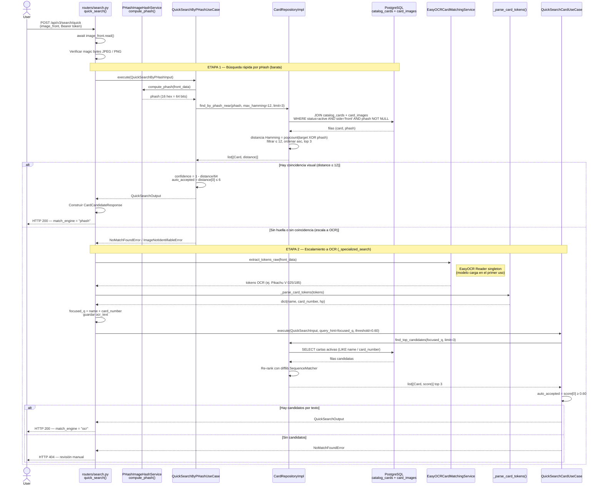

# Diagrama de Búsqueda Rápida — pHash con escalamiento a OCR (US-004)

> Flujo actualizado del endpoint `POST /api/v3/search/quick`.
> Antes la búsqueda rápida se hacía solo con OCR; ahora intenta **primero pHash**
> (similitud visual, barata) y solo **escala a OCR** si el pHash no resuelve.

---

## Diagrama de secuencia (Mermaid)

---

## Matriz del Diagrama

| Paso del diagrama | Criterio de aceptación relacionado | Componente de arquitectura lógica involucrado |
| --- | --- | --- |
| Usuario envía imagen de la carta para búsqueda rápida | US — Realizar búsqueda rápida de carta mediante imagen frontal | Frontend / Interfaz de usuario |
| Frontend envía POST /api/v3/search/quick con image_front | La búsqueda rápida debe recibir una imagen frontal y parámetros mínimos | API PokéGrading / routers/search.py - quick_search() |
| API lee la imagen enviada | La imagen debe procesarse como archivo de entrada antes de buscar | API PokéGrading / Endpoint de búsqueda |
| API verifica que la imagen sea JPEG o PNG (magic bytes) | Validación mínima del archivo antes de intentar identificarla | API PokéGrading / Validación de entrada |
| **[Etapa 1]** API calcula el pHash perceptual de la imagen | La identificación primaria debe ser visual y de bajo costo, sin OCR | Servicio de huella visual / PHashImageHashService |
| API delega al caso de uso QuickSearchByPHashUseCase | La lógica de búsqueda no vive en el endpoint sino en la capa de aplicación | Caso de uso QuickSearchByPHashUseCase |
| Se buscan cartas con pHash cercano (find_by_phash_near) | El sistema debe comparar la huella visual contra el catálogo de referencia | Repositorio de catálogo / CardRepositoryImpl |
| El repositorio consulta cartas activas con imagen de frente y pHash | La comparación se hace solo sobre cartas activas con imagen de referencia | Almacén lógico / PostgreSQL catalog_cards + card_images |
| Se calcula la distancia de Hamming y se filtran las ≤ 12 bits | La similitud visual se mide por bits distintos sobre el hash de 64 bits | Repositorio de catálogo / Algoritmo de distancia Hamming |
| Si hay coincidencia: confidence = 1 − distancia/64; auto_accepted si ≤ 6 bits | Si el mejor candidato supera el umbral visual, puede aceptarse automáticamente | Caso de uso pHash / Regla de confianza visual |
| API responde HTTP 200 con match_engine = "phash" | Resultado exitoso de la búsqueda rápida por similitud visual | API PokéGrading / Frontend |
| **[Escalamiento]** Si el pHash no identifica la carta, se escala a OCR | El sistema debe degradar a búsqueda por texto cuando no hay match visual (tolerancia a fallos) | API PokéGrading / routers/search.py - _specialized_search() |
| Se extraen tokens de texto desde la imagen usando OCR | El sistema debe identificar información de la carta a partir del texto cuando la imagen no coincide | Servicio de reconocimiento / EasyOCRCardMatchingService |
| Se procesan los tokens extraídos | La búsqueda debe reducir el texto OCR a datos útiles (nombre, número, HP) | Parser de búsqueda / _parse_card_tokens() |
| Se construye focused_q con nombre y número de carta | La búsqueda debe usar una consulta limpia para evitar ruido del OCR completo | API PokéGrading / Preparación de consulta |
| API delega al caso de uso QuickSearchCardUseCase con query_hint | Evita ejecutar OCR dos veces; la API ya procesó la imagen | Caso de uso QuickSearchCardUseCase |
| Se buscan candidatos en el catálogo (find_top_candidates) | El sistema debe devolver posibles cartas coincidentes por texto | Repositorio de catálogo / CardRepositoryImpl |
| El repositorio consulta cartas activas en catalog_cards (LIKE) | La búsqueda textual se realiza sobre cartas activas del catálogo | Almacén lógico / PostgreSQL catalog_cards |
| Se reordenan los candidatos con similitud textual (difflib) | El sistema debe priorizar los resultados más parecidos a la consulta OCR | Repositorio de catálogo / Algoritmo de ranking textual |
| Se calcula auto_accepted según el umbral de confianza (≥ 0.60) | Si el mejor candidato supera el confidence_threshold, puede aceptarse automáticamente | Caso de uso OCR / Regla de confianza textual |
| Si no hay candidatos, API responde HTTP 404 (revisión manual) | Cuando ni pHash ni OCR identifican la carta, se deriva a revisión manual | API PokéGrading / Frontend |
| Si hay candidatos, API responde HTTP 200 con match_engine = "ocr" | Resultado exitoso de la búsqueda por texto tras el escalamiento | API PokéGrading / Frontend |

---

## Diferencias clave frente al diagrama anterior (solo OCR)

1. **Nueva Etapa 1 (pHash)** antes del OCR: identificación visual barata. El OCR ya no es el camino principal.
2. **El OCR pasó a ser fallback** (escalamiento), no el primer intento.
3. **Nuevo campo `match_engine`** en la respuesta (`"phash"` o `"ocr"`) que indica qué motor resolvió.
4. **Nueva tabla involucrada**: `card_images` (con la columna `phash`), unida a `catalog_cards`.
5. **Dos umbrales distintos**: confianza visual (Hamming ≤ 6 / ≤ 12 sobre 64 bits) vs. confianza textual (≥ 0.60).
6. **Ruta actualizada**: `/api/v2/...` → `/api/v3/...`.

---

## Referencias de código

| Componente | Archivo |
| --- | --- |
| Endpoint y orquestación pHash→OCR | `src/pokegrading/api/v3/routers/search.py` → `quick_search()` / `_specialized_search()` |
| Caso de uso pHash | `src/pokegrading/application/use_cases/quick_search_by_phash.py` |
| Caso de uso OCR | `src/pokegrading/application/use_cases/quick_search_card.py` |
| Cálculo de pHash y distancia Hamming | `src/pokegrading/infrastructure/matching/phash_image_hash_service.py` |
| Búsqueda por pHash en BD | `src/pokegrading/infrastructure/persistence/repositories/card/card_repository.py` → `find_by_phash_near()` |
| Búsqueda y ranking por texto | `src/pokegrading/infrastructure/persistence/repositories/card/card_repository.py` → `find_top_candidates()` |
| Motor OCR | `src/pokegrading/infrastructure/matching/easyocr_card_matching_service.py` |
| Parser de tokens OCR | `src/pokegrading/api/v3/routers/search.py` → `_parse_card_tokens()` |
