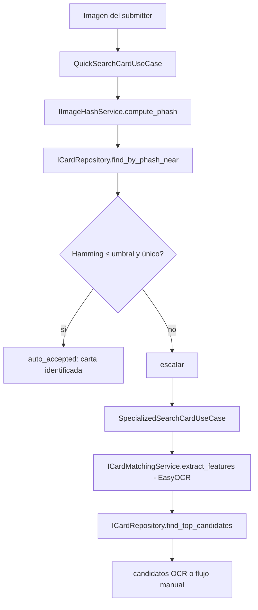

# Diseño de búsqueda: pHash (rápida) + OCR (especializada)

**Proyecto:** PokéGrading — Dr. Mundo Solutions
**Sprint:** 3
**Relacionado:** [ADR-003 — Búsqueda rápida (Sprint 2)](../../Sprint2/DOC/ADR-003-busqueda-rapida-de-carta.md), [diagramas-actividad.md](./diagramas-actividad.md)

---

## 1. Contexto y cambio respecto a Sprint 2

En Sprint 2 la **búsqueda rápida** (US-004) se resolvía con **EasyOCR** (`ADR-003`). El OCR es preciso para leer el texto impreso pero es **lento** (~1–3 s por imagen, ~5 s la primera) y pesado (~500 MB en RAM). Usarlo como **primer** intento penaliza cada identificación.

**Decisión Sprint 3:** invertir el orden de las dos estrategias.

| Etapa | Sprint 2 | Sprint 3 |
|---|---|---|
| Búsqueda **rápida** (1er intento) | OCR (EasyOCR) | **pHash** (perceptual hash) |
| Búsqueda **especializada/detallada** (fallback) | — | **OCR** (EasyOCR, ya implementado) |

El OCR **no se tira**: se reubica como motor de la búsqueda detallada cuando el pHash no resuelve con confianza.

---

## 2. ¿Qué es pHash y por qué para la búsqueda rápida?

**Perceptual hash (pHash):** una huella compacta (64 bits) que representa el contenido **visual** de una imagen. Imágenes visualmente similares producen hashes con pocos bits de diferencia (**distancia de Hamming** baeja), aunque cambien escala, compresión o iluminación leve.

| | pHash | OCR |
|---|---|---|
| Velocidad | ~milisegundos | ~1–3 s |
| RAM | mínima | ~500 MB |
| Compara | imagen completa vs imágenes de referencia | texto impreso vs nombres del catálogo |
| Falla cuando | no hay imagen de referencia, o foto muy distinta (ángulo extremo) | fuentes estilizadas, idiomas no soportados |

pHash es ideal como **primer filtro barato**: si la foto del usuario se parece mucho a una imagen de referencia del catálogo, se resuelve al instante. Si no, se escala al OCR (más caro pero más robusto a variaciones de encuadre/texto).

---

## 3. Arquitectura (Clean Architecture / Ports & Adapters)



### 3.1 Puerto nuevo — `IImageHashService`

```python
# application/ports/image_hash_service.py  (diseño)
class IImageHashService(ABC):
    @abstractmethod
    def compute_phash(self, image_data: bytes) -> str:
        """Devuelve el pHash como hex de 16 chars (64 bits). '' si la imagen es inválida."""

    @abstractmethod
    def hamming_distance(self, a: str, b: str) -> int:
        """Distancia de Hamming entre dos pHash hex."""
```

### 3.2 Adaptador — `PHashImageHashService`

```python
# infrastructure/matching/phash_image_hash_service.py  (diseño)
# Usa la librería `imagehash` (+ Pillow). Sin GPU, sin modelo descargado.
class PHashImageHashService(IImageHashService):
    def compute_phash(self, image_data: bytes) -> str:
        img = Image.open(io.BytesIO(image_data)).convert("RGB")
        return str(imagehash.phash(img))          # 16 hex chars

    def hamming_distance(self, a: str, b: str) -> int:
        return imagehash.hex_to_hash(a) - imagehash.hex_to_hash(b)
```

En tests se usará un `StubImageHashService` (igual patrón que `StubCardMatchingService`), sin dependencias pesadas.

---

## 4. Almacenamiento del pHash

El pHash de cada imagen de referencia se persiste **junto a la imagen** en `card_images`:

```
card_images
└── phash  CHAR(16)  NULL  [INDEX]    ← hex de 64 bits del pHash de la imagen de referencia
```

- Se calcula al subir la imagen de referencia (`POST /catalog/cards/{id}/images/{side}`) — un cálculo extra de milisegundos en el flujo de alta.
- **Backfill**: script que recorre las imágenes ya cargadas y rellena `phash`.
- Migración Alembic: `add_phash_to_card_images`.

> La búsqueda rápida solo usa la imagen del **frente** (`side='front'`), igual que el diseño de ADR-003.

### 4.1 Búsqueda por cercanía

`ICardRepository.find_by_phash_near(phash, max_hamming, limit)`:

- **Recall (SQL):** traer candidatos de cartas `active` con `phash` no nulo (en la escala actual, todo el conjunto con `front` cargado).
- **Precision (Python):** calcular distancia de Hamming contra el `phash` de la consulta; ordenar ascendente; filtrar `≤ max_hamming`.
- Auto-aceptación si el mejor candidato tiene Hamming `≤ umbral_auto` (p.ej. 6) **y** está suficientemente separado del segundo (margen) → evita falsos positivos entre variantes muy parecidas.

> **Nota de escalabilidad:** comparar contra todas las filas en Python es aceptable para el catálogo actual (cientos–miles). A mayor escala: índice BK-tree / `pg_bktree` / búsqueda por bloques de bits. Documentado como deuda para Sprint 4+ (igual criterio que el `LIKE` de ADR-003).

---

## 5. Escalamiento a la búsqueda especializada (OCR)

`QuickSearchCardUseCase` escala a `SpecializedSearchCardUseCase` cuando:

- No hay imágenes de referencia con `phash` (catálogo sin fotos para esa zona), **o**
- El mejor Hamming supera `umbral_auto`, **o**
- Hay empate dentro del margen (ambiguo).

La búsqueda especializada **reutiliza** el pipeline OCR existente de Sprint 2 (`EasyOCRCardMatchingService` + `find_top_candidates`), sin cambios en esa lógica. Si el OCR tampoco identifica → `ImageNotIdentifiableError` → flujo manual.

---

## 6. Endpoints

| Método | Ruta | Motor | Notas |
|---|---|---|---|
| `POST` | `/api/v2/search/quick` | pHash | Primer intento; puede auto-aceptar o escalar |
| `POST` | `/api/v2/search/specialized` | OCR | Búsqueda detallada (fallback explícito o auto-escalado) |

> Se mantiene `/search/quick` como nombre estable; cambia su **motor interno** (OCR → pHash). El endpoint OCR de Sprint 2 se renombra/expone como `/search/specialized`.

---

## 7. Tareas de implementación (Fase B)

- [ ] `application/ports/image_hash_service.py` → `IImageHashService`
- [ ] `infrastructure/matching/phash_image_hash_service.py` → `PHashImageHashService` (+ stub para tests)
- [ ] `requirements.txt` → `imagehash` (+ `Pillow`, ya presente)
- [ ] `persistence/models.py` → columna `phash CHAR(16)` indexada en `CardImageORM`
- [ ] Migración Alembic `add_phash_to_card_images` + backfill
- [ ] Calcular pHash en `upload_card_image` (router catálogo)
- [ ] `ICardRepository.find_by_phash_near` + impl
- [ ] `QuickSearchCardUseCase` → pHash primero, escalar a OCR
- [ ] `SpecializedSearchCardUseCase` → ruta OCR (reusa Sprint 2)
- [ ] `routers/search.py` → `/search/quick` (pHash) y `/search/specialized` (OCR)
- [ ] Tests: pHash exacto / cercano / ambiguo→OCR / sin coincidencia

---

## 8. Ventajas y desventajas

| | Detalle |
|---|---|
| ✅ Primer intento barato | pHash resuelve en milisegundos sin cargar el modelo OCR |
| ✅ OCR reutilizado | El motor de Sprint 2 no se descarta; pasa a fallback robusto |
| ✅ Testeable sin GPU | `StubImageHashService` evita dependencias pesadas en tests |
| ✅ Degradación elegante | pHash → OCR → manual: siempre hay una salida |
| ❌ Requiere imágenes de referencia | El pHash solo sirve si la carta del catálogo tiene foto frontal; sin foto se escala directo a OCR |
| ❌ Comparación lineal en Python | A gran escala necesita índice especializado (deuda Sprint 4+) |
| ❌ Sensible a ángulo extremo | Una foto muy torcida da Hamming alto → se escala a OCR (comportamiento esperado, no un bug) |

---

## Referencias

- [ADR-003 — Búsqueda rápida de carta (Sprint 2)](../../Sprint2/DOC/ADR-003-busqueda-rapida-de-carta.md)
- [diagramas-actividad.md](./diagramas-actividad.md) §1 (flujo de grading corregido)
- [diagramas-secuencia.md](./diagramas-secuencia.md) §6
- [imagehash — PyPI](https://pypi.org/project/ImageHash/)
- [Perceptual hashing — Hacker Factor (pHash explicado)](https://www.hackerfactor.com/blog/index.php?/archives/432-Looks-Like-It.html)
