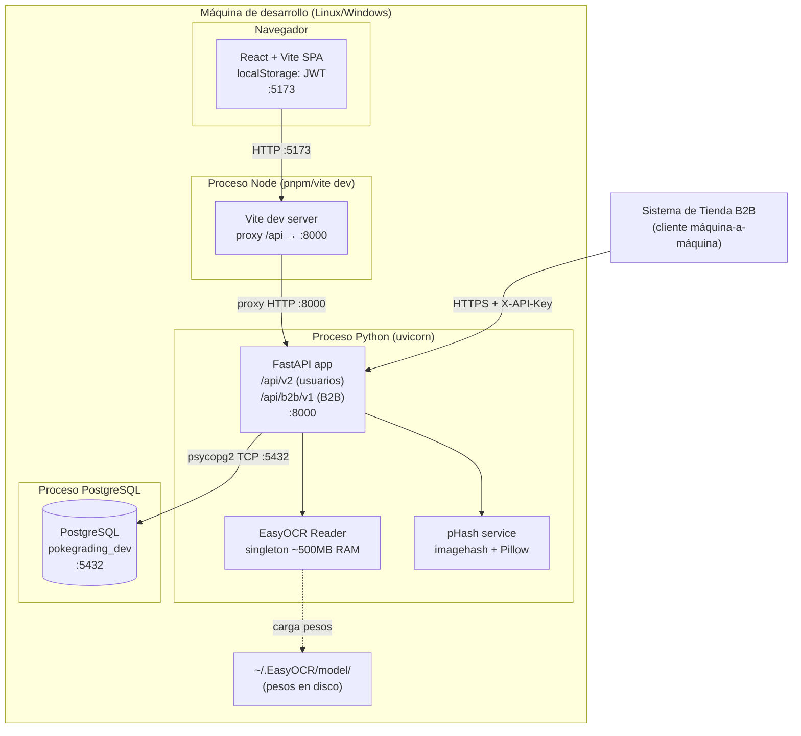
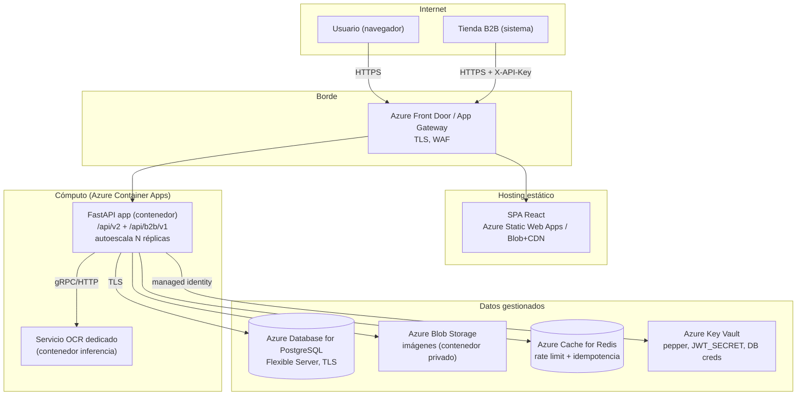
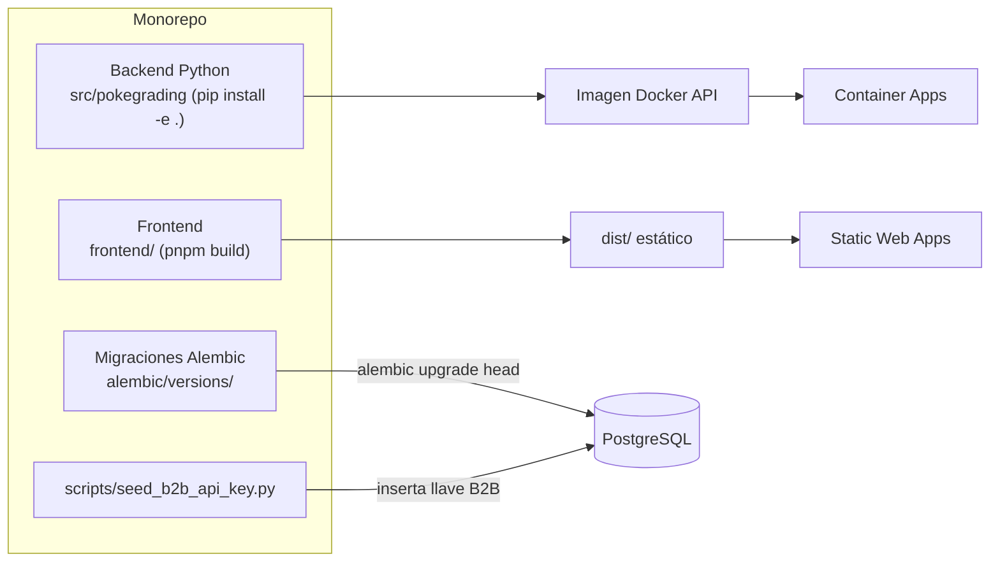

# Diagrama físico de la solución — primera versión (Sprint 3)

**Proyecto:** PokéGrading — Dr. Mundo Solutions
**Sprint:** 3
**Relacionado:** [ADR-002 — Almacenamiento](../../Sprint2/DOC/ADR-002-diseno-almacenamiento.md), [ADR-004 — API B2B](./ADR-004-api-b2b-lookup-catalogo.md)

> Primera versión del **diagrama físico** (vista de despliegue): nodos de hardware/runtime, los artefactos que corren en cada uno y los protocolos de comunicación. Se presenta el estado de **desarrollo** y la **proyección a producción (Azure)**.

---

## 1. Vista de despliegue — Desarrollo (local)

| Nodo | Artefacto | Puerto/Protocolo |
|---|---|---|
| Navegador | SPA React (build Vite) | HTTP :5173 |
| Proceso Node | Vite dev server (proxy a `/api`) | :5173 → :8000 |
| Proceso Python | FastAPI + Uvicorn (`pokegrading.main:app`) | :8000 |
| — | EasyOCR singleton (búsqueda especializada) | en-proceso |
| — | pHash service (búsqueda rápida) | en-proceso |
| Proceso PostgreSQL | BD relacional + BYTEA de imágenes | TCP :5432 |
| Disco | Pesos EasyOCR (`~/.EasyOCR/`) | filesystem |
| Externo | Sistema de tienda B2B | HTTPS + `X-API-Key` |

---

## 2. Vista de despliegue — Producción (Azure, proyección)

### 2.1 Diferencias dev → producción

| Componente | Desarrollo | Producción |
|---|---|---|
| SPA | Vite dev server | Static Web Apps / Blob + CDN |
| API | Uvicorn local | Container Apps (autoescala) |
| OCR | Singleton en-proceso | Contenedor de inferencia dedicado |
| Imágenes | BYTEA en PostgreSQL | Azure Blob Storage privado (SAS) |
| Rate limit / idempotencia | Tablas en PostgreSQL | Azure Cache for Redis |
| Secretos | `.env` | Azure Key Vault + managed identity |
| TLS | Opcional (localhost) | Obligatorio (Front Door / App Gateway) |

> Coherente con el "Plan de evolución a producción" de [ADR-002](../../Sprint2/DOC/ADR-002-diseno-almacenamiento.md). El API B2B (§ ADR-004) añade Redis para rate limit/idempotencia como única infraestructura nueva respecto a Sprint 2.

---

## 3. Artefactos desplegables

| Artefacto | Cómo se produce | Dónde corre |
|---|---|---|
| Imagen Docker del API | `Dockerfile` sobre `src/pokegrading` | Container Apps |
| Bundle estático SPA | `pnpm build` → `frontend/dist` | Static Web Apps / CDN |
| Migraciones | `alembic upgrade head` | Job previo al despliegue |
| Seed de llave B2B | `python scripts/seed_b2b_api_key.py` | Job manual/operación |

---

## 4. Nota de evolución

Esta es la **primera versión** del diagrama físico. Pendiente de refinar en sprints futuros:

- Topología de red (VNet, subredes privadas, private endpoints para PostgreSQL/Blob).
- Estrategia de réplicas de lectura de PostgreSQL si la carga de lookup crece.
- Observabilidad (Azure Monitor / App Insights) y correlación por `trace_id`.
- Estrategia de despliegue (blue/green o canary) para el contrato B2B versionado.

---

## Referencias

- [ADR-002 — Almacenamiento del sistema](../../Sprint2/DOC/ADR-002-diseno-almacenamiento.md)
- [ADR-004 — API B2B](./ADR-004-api-b2b-lookup-catalogo.md)
- [diseno-versionamiento-seguridad-api.md](./diseno-versionamiento-seguridad-api.md)
