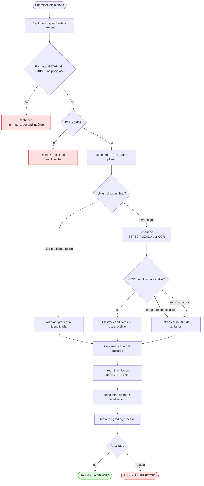
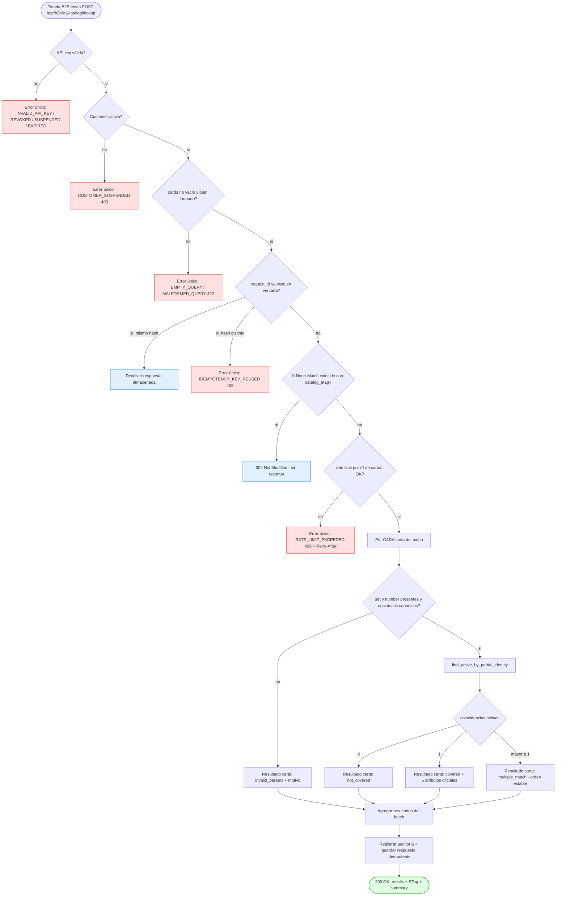
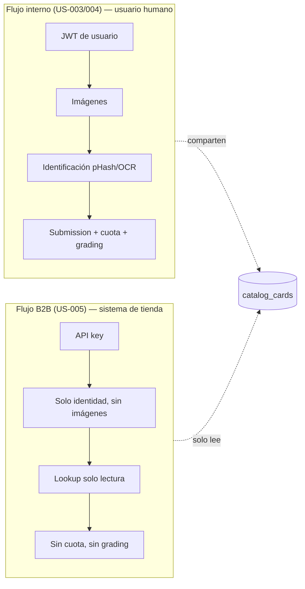

# Diagramas de actividad — Sprint 3

**Proyecto:** PokéGrading — Dr. Mundo Solutions
**Sprint:** 3
**Relacionado:** [ADR-004](./ADR-004-api-b2b-lookup-catalogo.md), [diagramas-secuencia.md](./diagramas-secuencia.md)

> Diagramas en **Mermaid** (renderizables en la wiki de Azure DevOps y en GitHub).

---

## 1. Flujo completo de grading de una carta — versión corregida

### 1.1 Correcciones aplicadas respecto a la versión anterior

| # | Corrección | Motivo |
|---|---|---|
| C1 | La **búsqueda rápida** ahora usa **pHash** (no OCR). El OCR pasa a la **búsqueda especializada/detallada**. | Alinear con el diseño de [busqueda-phash-ocr.md](./busqueda-phash-ocr.md): pHash es más rápido para el primer intento. |
| C2 | Se explicita la rama **"imagen no identificable"** → deriva a entrada **manual** de atributos. | El flujo anterior no mostraba la salida de `ImageNotIdentifiableError`. |
| C3 | Se añade el **gate de calidad de imagen (IQS ≥ 0.60)** antes de cualquier identificación. | Coincide con `SubmitCardForEvaluationUseCase` (US-003); el diagrama viejo validaba calidad después. |
| C4 | Se separa **identificación** (qué carta es) de **envío a evaluación** (persistir submission). | Eran un solo nodo ambiguo; ahora son dos actividades con su propio resultado. |
| C5 | Se marca explícitamente que la **cuota de evaluación** se descuenta **solo** al confirmar el envío, no durante la búsqueda. | Evita la confusión con el lookup B2B (que nunca toca cuota). |
| C6 | Estados terminales nombrados (`GRADED`, `REJECTED`, `PENDING`) según `SubmissionStatus`. | El diagrama viejo terminaba en "fin" genérico. |

### 1.2 Diagrama

> **Nota:** la cuota solo se descuenta en el nodo `quota`, **después** de confirmar la carta. Ni la búsqueda rápida ni la especializada consumen cuota — y el **lookup B2B (§2) nunca llega a este flujo**.

---

## 2. Flujo B2B — Consultar cobertura de catálogo (US-005)

Diagrama de actividad del nuevo requerimiento. Refleja el diseño de [ADR-004](./ADR-004-api-b2b-lookup-catalogo.md): autenticación → idempotencia → rate limit → resolución por carta → auditoría.

### 2.1 Puntos clave del flujo B2B

| Característica | Reflejado en el diagrama |
|---|---|
| Solo lectura, sin cuota | No existe nodo de descuento de cuota; nunca entra al flujo de grading (§1) |
| Resolución independiente por carta | El bucle `loop` resuelve cada carta; `invalid_params` no aborta el batch (AC-05) |
| Carta retirada → `not_covered` | `find_active_by_partial_identity` solo cuenta activas; retiradas caen en `count = 0` |
| Idempotencia y ETag antes del rate limit | Un hit idempotente o un `304` **no** consumen tokens (AC-08/AC-09) |
| Formato de error único | Todas las ramas `:::err` emiten el mismo formato con `trace_id` (AC-11) |
| Auditoría siempre | El nodo `audit` se ejecuta en todo `200` real (AC-15) |

---

## 3. Comparación de los dos flujos (por qué no se cruzan)

Ambos flujos comparten **únicamente** la tabla `catalog_cards`: el interno la usa para identificar y luego evaluar; el B2B **solo la lee** para reportar cobertura.

---

## Referencias

- [ADR-004 — API B2B](./ADR-004-api-b2b-lookup-catalogo.md)
- [busqueda-phash-ocr.md](./busqueda-phash-ocr.md)
- [diagramas-secuencia.md](./diagramas-secuencia.md)
- [ADR-003 — Búsqueda rápida (Sprint 2)](../../Sprint2/DOC/ADR-003-busqueda-rapida-de-carta.md)
