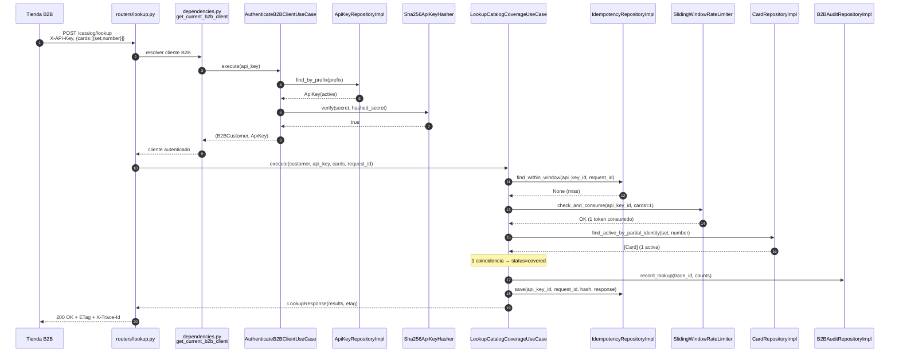
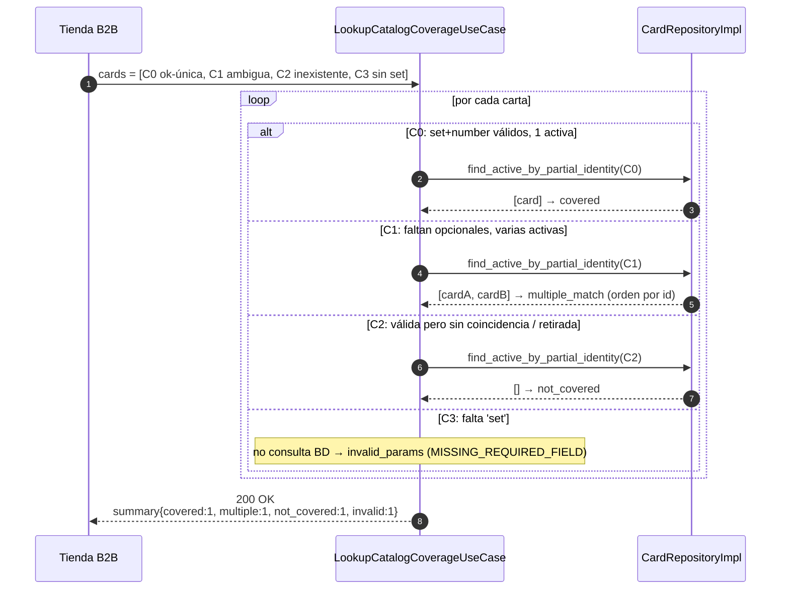
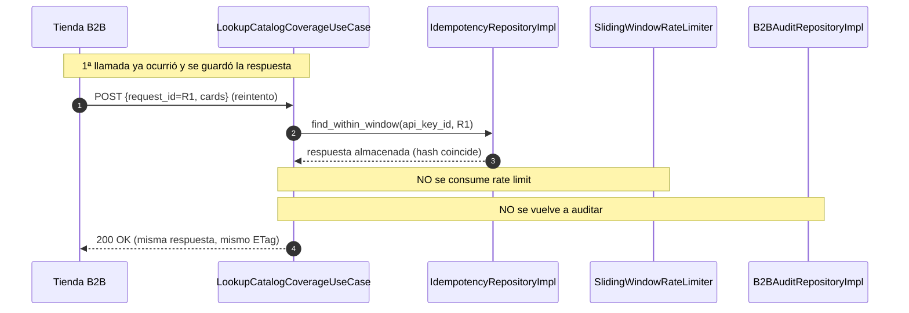
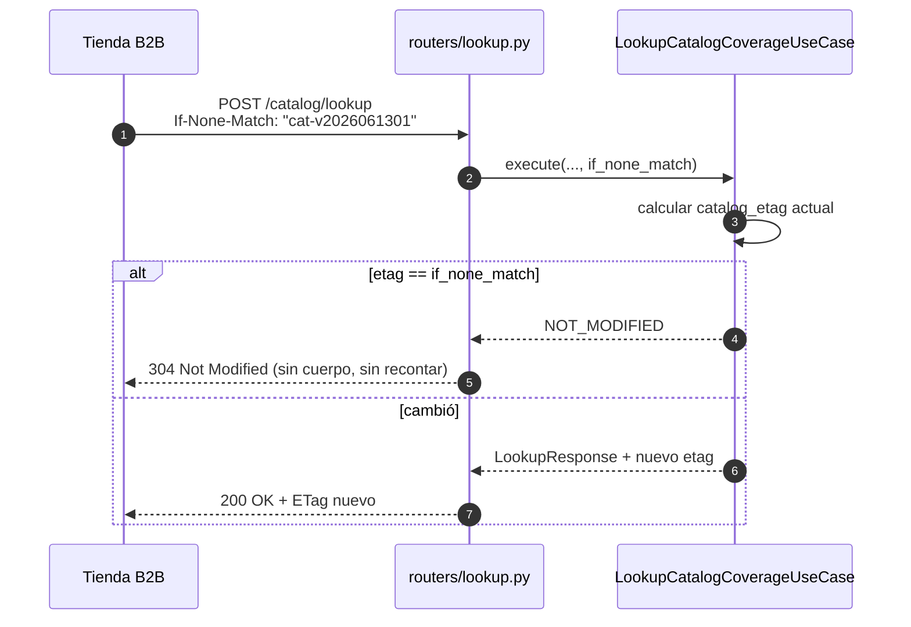
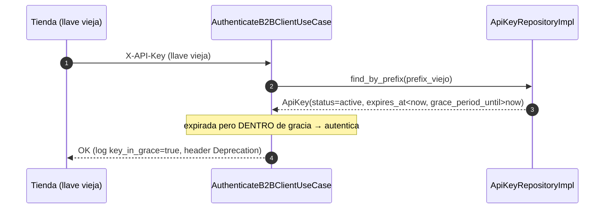
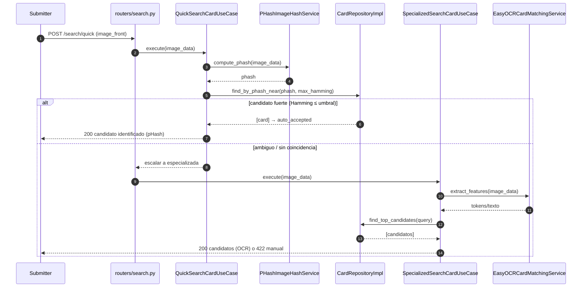

# Diagramas de secuencia — escenarios de éxito (Sprint 3)

**Proyecto:** PokéGrading — Dr. Mundo Solutions
**Sprint:** 3
**Relacionado:** [ADR-004](./ADR-004-api-b2b-lookup-catalogo.md), [diseno-versionamiento-seguridad-api.md](./diseno-versionamiento-seguridad-api.md)

> Las etiquetas usan los **nombres reales de archivo y clase** del código (Fase B), siguiendo la convención adoptada en Sprint 2 (TODO §3).

---

## 1. Lookup de cobertura — escenario de éxito (carta cubierta)

`POST /api/b2b/v1/catalog/lookup` con una API key válida y una carta que existe activa.

---

## 2. Lookup batch con estados mixtos (covered + multiple + not_covered + invalid)

Un solo request con varias cartas; cada una resuelve de forma independiente (AC-05).

---

## 3. Idempotencia — reintento con el mismo `request_id`

Segunda llamada idéntica dentro de la ventana: misma respuesta, sin recontar ni reauditar (AC-08).

---

## 4. Validación condicional — `304 Not Modified`

La tienda reenvía `If-None-Match` y el catálogo no cambió (AC-09).

---

## 5. Autenticación B2B con periodo de gracia (rotación de llave)

La llave vieja, dentro de su periodo de gracia, sigue autenticando con advertencia (ver [seguridad §5](./diseno-versionamiento-seguridad-api.md)).

---

## 6. Búsqueda rápida por pHash con escalamiento a OCR (flujo interno)

Escenario de éxito del nuevo diseño de búsqueda (ver [busqueda-phash-ocr.md](./busqueda-phash-ocr.md)).

---

## 7. Trazabilidad secuencia → código (Fase B)

| Participante en diagramas | Archivo de código a implementar |
|---|---|
| `routers/lookup.py` | `api/b2b/v1/routers/lookup.py` |
| `dependencies.py / get_current_b2b_client` | `api/b2b/v1/dependencies.py` |
| `AuthenticateB2BClientUseCase` | `application/use_cases/authenticate_b2b_client.py` |
| `LookupCatalogCoverageUseCase` | `application/use_cases/lookup_catalog_coverage.py` |
| `ApiKeyRepositoryImpl` / `Sha256ApiKeyHasher` | `infrastructure/persistence/repositories/b2b/api_key_repository.py` / `infrastructure/security/api_key.py` |
| `IdempotencyRepositoryImpl` / `B2BAuditRepositoryImpl` | `infrastructure/persistence/repositories/b2b/*` |
| `SlidingWindowRateLimiter` | `infrastructure/ratelimit/sliding_window_rate_limiter.py` |
| `CardRepositoryImpl.find_active_by_partial_identity` | `infrastructure/persistence/repositories/card/card_repository.py` |
| `PHashImageHashService` / `QuickSearchCardUseCase` | `infrastructure/matching/phash_image_hash_service.py` / `application/use_cases/quick_search_card.py` |

---

## Referencias

- [ADR-004 — API B2B](./ADR-004-api-b2b-lookup-catalogo.md)
- [diseno-versionamiento-seguridad-api.md](./diseno-versionamiento-seguridad-api.md)
- [busqueda-phash-ocr.md](./busqueda-phash-ocr.md)
- [diagramas-actividad.md](./diagramas-actividad.md)
