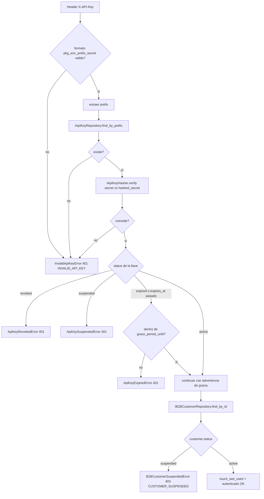
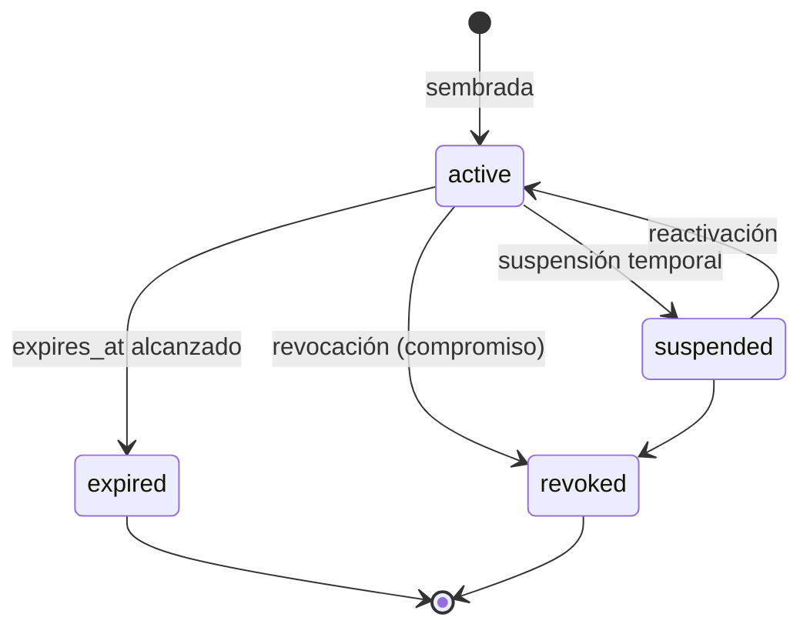
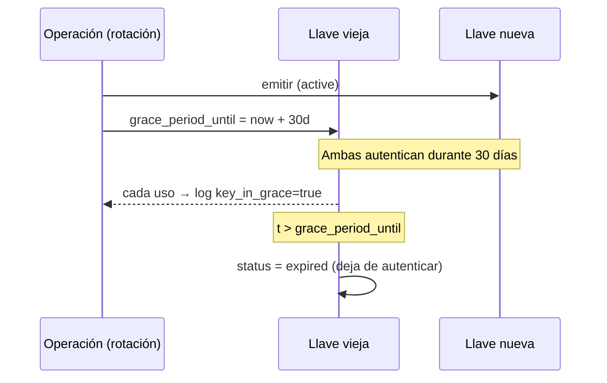

# Diseño de versionamiento y seguridad del API B2B

**Proyecto:** PokéGrading — Dr. Mundo Solutions
**Sprint:** 3
**Relacionado:** [ADR-004](./ADR-004-api-b2b-lookup-catalogo.md), [diseno-datos-sensibles.md](./diseno-datos-sensibles.md)

> **Alcance de Sprint 3:** en este sprint **no se implementa el aprovisionamiento** (no hay endpoint ni UI para crear/rotar llaves). Sin embargo, las llaves **deben existir** para que la autenticación funcione. Por eso este documento define la **estructura de las llaves**, su **ciclo de vida** (incluyendo **periodos de gracia** y **estrategia de revocación**) y cómo se **siembran** manualmente. El aprovisionamiento self-service queda para Sprint 4+.

---

## 1. Versionamiento del API

### 1.1 Dos superficies, dos esquemas de versión

| Superficie | Audiencia | Ruta base | Versionado |
|---|---|---|---|
| API interno | Usuarios (frontend React) | `/api/v2` | Por path (`v2`, ya existente) |
| **API B2B** | Sistemas de tiendas | `/api/b2b/v1` | **Por path, independiente** |

**Decisión:** el API B2B se versiona **por separado** del API interno. Razón: los ciclos de vida son distintos — el contrato B2B es público para terceros y debe mantener compatibilidad estricta, mientras que `/api/v2` evoluciona al ritmo del frontend propio.

### 1.2 Política de compatibilidad (SemVer de contrato)

| Tipo de cambio | Ejemplo | Acción |
|---|---|---|
| **No-breaking** | Nuevo campo opcional en la respuesta; nuevo `code` de error | Misma versión (`v1`) |
| **Breaking** | Campo requerido nuevo; renombrar/eliminar campo; cambiar tipo o semántica de un estado | Nueva versión (`/api/b2b/v2`) |

- Los **códigos de error** (`code`) son parte del contrato y **estables**: nunca se renombran dentro de una versión.
- El campo `message` **no** es contrato (puede cambiar/traducirse).
- Dos versiones mayores pueden coexistir durante un periodo de deprecación anunciado por header `Deprecation` + `Sunset` (RFC 8594).

### 1.3 Negociación de versión

- La versión vive en el **path** (`/api/b2b/v1`), no en headers — explícito y cacheable.
- Header informativo `X-API-Version: 1` en cada respuesta.

---

## 2. Estructura de la API key

### 2.1 Formato del token

```
pkg_live_a1b2c3d4_Zk9Qn2xR7sT1vB4yH8mE0wC5uA3oL6dF
└┬┘ └─┬┘ └──┬───┘ └──────────────┬───────────────┘
 │    │     │                    │
 │    │     │                    └─ secret  (32 chars url-safe, ALTA entropía) — NUNCA se almacena en claro
 │    │     └─ prefix  (8 chars)  — identificador PÚBLICO, indexado, se almacena en claro
 │    └─ environment  (live | test)
 └─ product prefix  (pkg = PokéGrading)
```

| Parte | Propósito |
|---|---|
| `pkg` | Marca de producto — permite reconocer la llave en logs/leaks |
| `live` / `test` | Ambiente — una llave `test` nunca opera contra datos `live` |
| `prefix` (8) | **Público**. Se almacena en claro en `api_keys.key_prefix` (UNIQUE, indexado). Es lo que se usa para **localizar** la llave en O(1) sin exponer el secreto. |
| `secret` (32) | **Privado**. Solo se almacena su hash (`hashed_secret`). Se muestra en claro **una única vez** al sembrarla. |

### 2.2 Por qué prefix público + secret hasheado

El patrón "prefix + secret" (usado por Stripe, GitHub, etc.) resuelve dos problemas a la vez:

1. **Lookup eficiente:** sin el prefix, habría que hacer `verify()` contra **todas** las llaves de la tabla en cada request. Con el prefix, se localiza la fila candidata por índice y se hace **un solo** `verify()`.
2. **Detección de fugas:** el prefix identifica la llave en logs sin revelar el secreto; permite revocar una llave concreta si aparece filtrada.

### 2.3 Almacenamiento

Tabla `api_keys` (esquema completo en [ADR-004](./ADR-004-api-b2b-lookup-catalogo.md) §7). Campos relevantes para seguridad:

| Columna | Contenido |
|---|---|
| `key_prefix` | Prefix público (`a1b2c3d4`), UNIQUE, indexado |
| `hashed_secret` | `HMAC-SHA256(secret, pepper)` en hex — ver §4 |
| `status` | `active` / `suspended` / `revoked` / `expired` |
| `scopes` | Permisos (`catalog:lookup`) — preparado para crecer |
| `expires_at` | Caducidad natural de la llave |
| `grace_period_until` | Fin del periodo de gracia tras rotación (ver §5) |
| `revoked_at` | Momento de revocación (revocación inmediata) |
| `last_used_at` | Telemetría / detección de llaves muertas |

---

## 3. Flujo de autenticación

`AuthenticateB2BClientUseCase` (capa de aplicación). El dominio nunca ve FastAPI.



**Orden de verificación (importante):** primero validez criptográfica del secreto, luego estado de la llave, luego estado del customer. Así un atacante con un prefix válido pero secreto incorrecto **nunca** distingue entre "llave revocada" y "secreto incorrecto" (ambos → `INVALID_API_KEY` salvo que el secreto sea correcto).

> **Rechazo total (AC-10):** cualquier fallo de autenticación rechaza la **consulta completa** con el formato de error único, sin procesar ninguna carta.

---

## 4. Hashing de la API key

**Decisión:** `HMAC-SHA256(secret, pepper)`, **no** bcrypt.

| | Razón |
|---|---|
| ❌ bcrypt | bcrypt está diseñado para secretos de **baja entropía** (contraseñas humanas) y es deliberadamente lento. Aplicarlo en **cada request** B2B (potencialmente miles/min) añadiría ~300 ms por llamada — inaceptable. |
| ✅ HMAC-SHA256 | El secreto de 32 chars url-safe tiene ~190 bits de entropía: no es atacable por fuerza bruta/diccionario, así que no se necesita un hash lento. HMAC con un **pepper** secreto (env var `B2B_API_KEY_PEPPER`, fuera de la BD) protege incluso si la tabla `api_keys` se filtra. |

```python
# infrastructure/security/api_key.py  (diseño)
class Sha256ApiKeyHasher(IApiKeyHasher):
    def __init__(self, pepper: str) -> None:
        self._pepper = pepper.encode()

    def hash(self, secret: str) -> str:
        return hmac.new(self._pepper, secret.encode(), hashlib.sha256).hexdigest()

    def verify(self, secret: str, hashed: str) -> bool:
        return hmac.compare_digest(self.hash(secret), hashed)  # tiempo constante
```

- `hmac.compare_digest` → comparación en **tiempo constante** (evita timing attacks).
- El **pepper** vive en variable de entorno / Azure Key Vault, **nunca** en la BD ni en el código (ver [diseno-datos-sensibles.md](./diseno-datos-sensibles.md)).

---

## 5. Ciclo de vida, periodos de gracia y rotación

### 5.1 Estados de la llave



| Estado | Autentica | Reversible | Uso |
|---|---|---|---|
| `active` | Sí | — | Operación normal |
| `suspended` | No | Sí (→ `active`) | Pausa temporal (impago, investigación) |
| `expired` | Solo dentro del periodo de gracia | No | Caducidad natural |
| `revoked` | **Nunca** | No | Compromiso / fuga — inmediato |

### 5.2 Periodo de gracia (rotación sin downtime)

Cuando una llave se **rota** (se emite una nueva para reemplazarla), la llave vieja **no se invalida de inmediato**: se le fija `grace_period_until = now + 30 días` (configurable `B2B_KEY_GRACE_DAYS`). Durante la gracia:

- **Ambas** llaves (vieja y nueva) autentican correctamente.
- La tienda migra sus sistemas a la nueva llave sin interrupción.
- Cada uso de la llave vieja durante la gracia se **loggea con una advertencia** (`key_in_grace=true`) y puede devolver el header `Deprecation`.
- Al pasar `grace_period_until`, la llave vieja pasa a `expired` y deja de autenticar.



### 5.3 Estrategia de revocación

| Aspecto | Decisión |
|---|---|
| Disparador | Fuga del secreto, compromiso del customer, fin de contrato |
| Mecanismo | `status = revoked`, `revoked_at = now` |
| **Efecto** | **Inmediato** — sin periodo de gracia. La revocación es la diferencia clave frente a la expiración. |
| Por qué funciona | A diferencia de un JWT (stateless, no revocable antes de expirar — ver [ADR-002](../../Sprint2/DOC/ADR-002-diseno-almacenamiento.md) §4), **cada request B2B consulta `api_keys` en la BD**. Cambiar `status` a `revoked` surte efecto en el siguiente request, sin blacklist adicional. |
| Granularidad | Por llave (no por customer): revocar una llave comprometida no corta las demás llaves del mismo customer. |
| Suspensión del customer | Ortogonal: `b2b_customers.status = suspended` rechaza **todas** las llaves de ese customer (`CUSTOMER_SUSPENDED` 403). |

> **Ventaja de diseño:** las API keys son revocables en tiempo real precisamente porque son *stateful* (viven en la BD y se consultan en cada request), resolviendo la limitación conocida del JWT documentada en ADR-002.

---

## 6. Siembra de llaves (sin aprovisionamiento)

Como Sprint 3 **no** incluye endpoint de aprovisionamiento, las llaves se crean con un **script idempotente** `scripts/seed_b2b_api_key.py`:

```
1. Genera secret aleatorio (secrets.token_urlsafe(24) → ~32 chars).
2. Genera prefix (secrets.token_hex(4) → 8 chars).
3. Compone la llave:  pkg_<env>_<prefix>_<secret>
4. Inserta b2b_customers (si no existe) + api_keys (hashed_secret = hasher.hash(secret)).
5. Imprime la llave EN CLARO una sola vez en stdout (jamás se vuelve a poder recuperar).
```

- El secreto en claro **solo** existe en ese momento; la BD guarda únicamente el hash.
- El script es la única vía de creación en Sprint 3 y deja la fila lista para autenticar.
- Se documenta en el README/SETUP cómo ejecutarlo y entregar la llave a la tienda por canal seguro.

---

## 7. Transporte y cabeceras de seguridad

| Mecanismo | Decisión |
|---|---|
| TLS | Obligatorio en producción (HTTPS). La API key viaja en header `X-API-Key` sobre TLS. |
| Header de llave | `X-API-Key` (no en query string — evita que quede en logs de acceso/CDN) |
| CORS | El API B2B **no** habilita CORS de navegador (es máquina-a-máquina); el `CORSMiddleware` existente solo aplica a `/api/v2` para el frontend |
| Cabeceras de respuesta | `X-Trace-Id`, `ETag`, `X-API-Version`, `Retry-After` (en 429), `Deprecation`/`Sunset` (llaves en gracia o versión obsoleta) |
| Rate limiting | Ver [ADR-004](./ADR-004-api-b2b-lookup-catalogo.md) §4 |

---

## 8. Checklist de seguridad (Fase B)

- [ ] El secreto **nunca** se almacena en claro ni se loggea (solo `key_prefix`).
- [ ] `hmac.compare_digest` para verificación en tiempo constante.
- [ ] Pepper en variable de entorno / Key Vault, fuera de la BD.
- [ ] Revocación efectiva al siguiente request (consulta a BD por request).
- [ ] Periodo de gracia configurable; uso de llave en gracia loggeado.
- [ ] Suspensión de customer corta todas sus llaves.
- [ ] API key por header, nunca por query string.
- [ ] Formato de error único sin filtrar si el fallo fue "secreto malo" vs "llave revocada".

---

## Referencias

- [ADR-004 — API B2B de cobertura de catálogo](./ADR-004-api-b2b-lookup-catalogo.md)
- [diseno-datos-sensibles.md](./diseno-datos-sensibles.md)
- [ADR-002 — Almacenamiento (JWT stateless vs API key stateful)](../../Sprint2/DOC/ADR-002-diseno-almacenamiento.md)
- [OWASP — Secrets Management Cheat Sheet](https://cheatsheetseries.owasp.org/cheatsheets/Secrets_Management_Cheat_Sheet.html)
- [RFC 8594 — The Sunset HTTP Header Field](https://www.rfc-editor.org/rfc/rfc8594)
