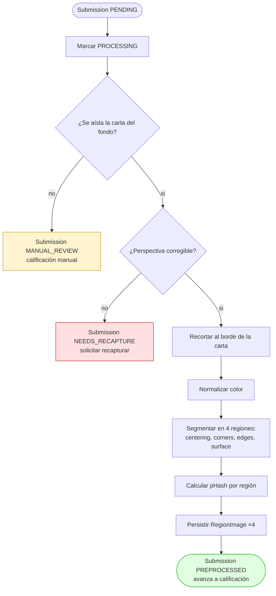
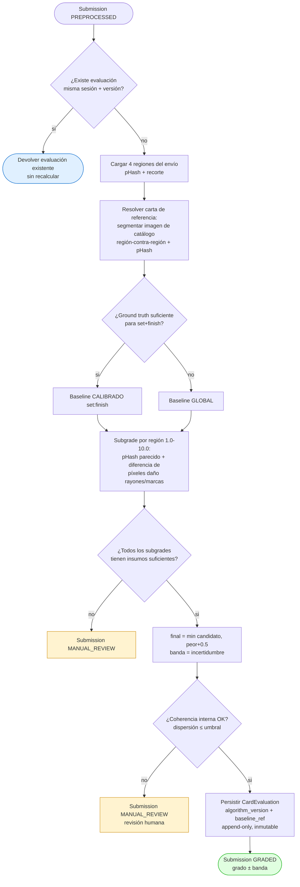
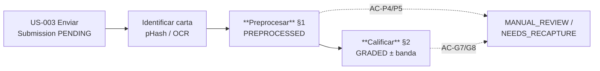

# Diagramas de actividad — Preprocesar carta y Calificar carta (Sprint 4)

**Proyecto:** PokéGrading — Dr. Mundo Solutions
**Sprint:** 4
**Relacionado:** [ADR-005](./ADR-005-preprocesamiento-y-calificacion.md) · [diagramas-secuencia.md](./diagramas-secuencia.md)

> Estos diagramas hacen *zoom* sobre los nodos `preprocesar` y `calificar` del [flujo de grading completo de Sprint 3 §1](../../Sprint3/DOC/diagramas-actividad.md). Mermaid renderizable en GitHub / wiki Azure DevOps.

---

## 1. Preprocesar carta

| AC | Reflejado en |
|---|---|
| AC-P1 | nodos `persp` → `crop` → `color` |
| AC-P2 | nodo `seg` (4 regiones) |
| AC-P3 | salida `ok` (PREPROCESSED → calificación) |
| AC-P4 | rama `iso -- no` → MANUAL_REVIEW |
| AC-P5 | rama `persp -- no` → NEEDS_RECAPTURE |

---

## 2. Calificar carta

| AC | Reflejado en |
|---|---|
| AC-G1 | nodo `sub` (subgrade por dimensión, 1.0–10.0 = pHash + daño local) |
| AC-G2 | bifurcación `base` (calibrado vs. global, registrado en output) |
| AC-G3 | nodo `coh` (`final = min(candidato, peor+0.5)`) |
| AC-G4 | nodo `coh` (banda de incertidumbre) |
| AC-G5 | nodo `persist` (versión + append-only inmutable) |
| AC-G6 | bifurcación `idem` (reuse sin recalcular) |
| AC-G7 | rama `ins -- no` → MANUAL_REVIEW |
| AC-G8 | rama `internal -- no` → MANUAL_REVIEW |

---

## 3. Ubicación dentro del flujo de grading (Sprint 3)

Los nodos en negrita son las dos actividades nuevas de Sprint 4. El resto ya existía en Sprint 1–3.

---

## Referencias

- [ADR-005](./ADR-005-preprocesamiento-y-calificacion.md)
- [diseno-preprocesamiento-calificacion.md](./diseno-preprocesamiento-calificacion.md)
- [diagramas-secuencia.md](./diagramas-secuencia.md)
- [diagramas-actividad.md (Sprint 3)](../../Sprint3/DOC/diagramas-actividad.md)
