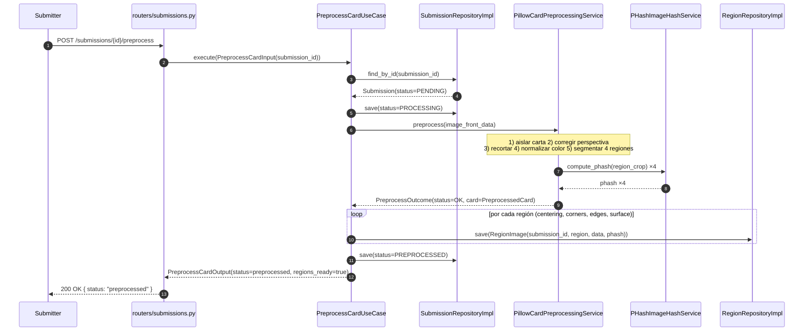
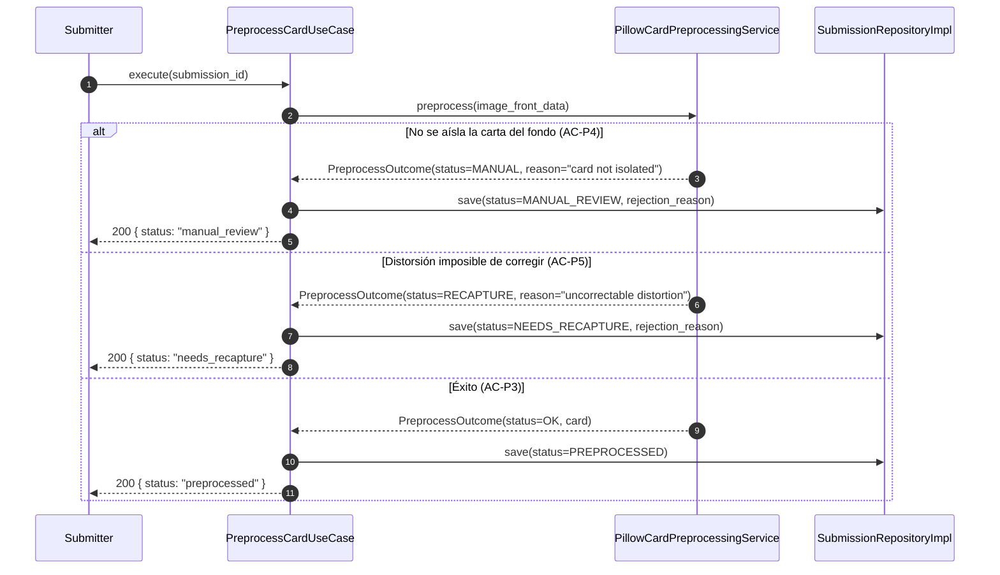
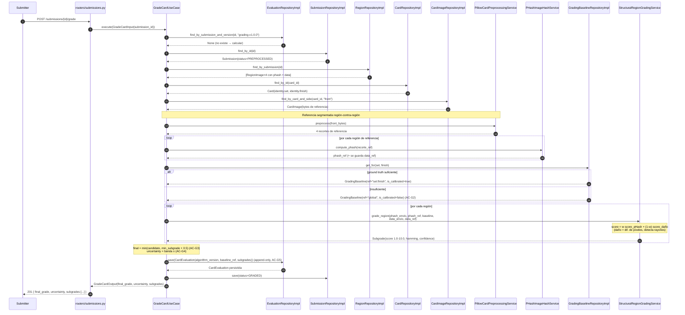
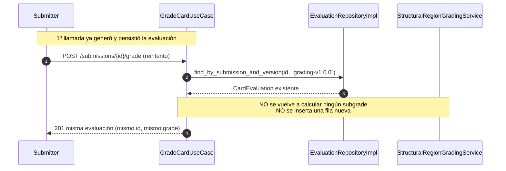
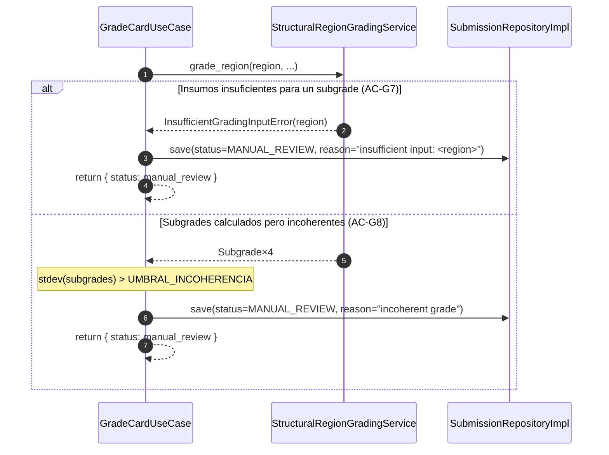
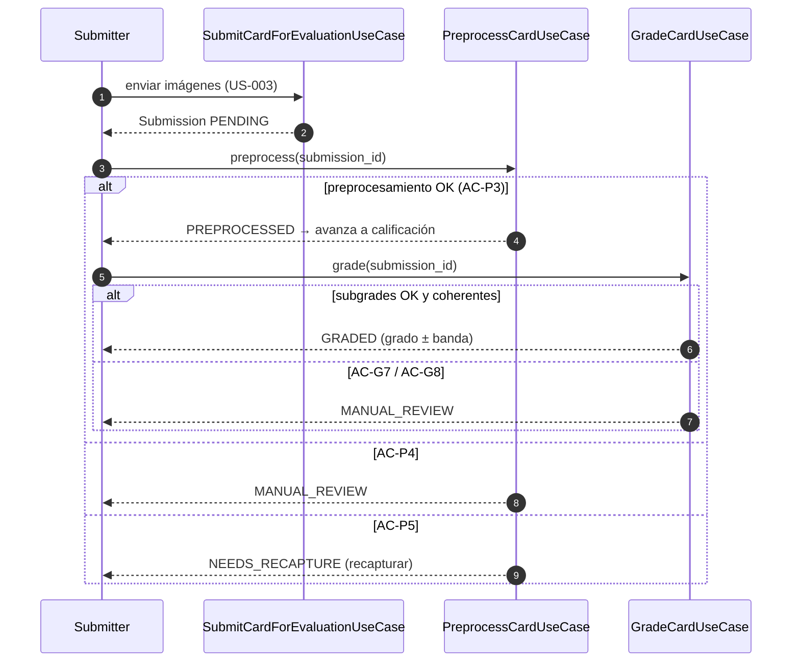

# Diagramas de secuencia — Preprocesar carta y Calificar carta (Sprint 4)

**Proyecto:** PokéGrading — Dr. Mundo Solutions
**Sprint:** 4
**Relacionado:** [ADR-005](./ADR-005-preprocesamiento-y-calificacion.md) · [diseno-preprocesamiento-calificacion.md](./diseno-preprocesamiento-calificacion.md) · [diagramas-actividad.md](./diagramas-actividad.md)

> Las etiquetas usan los **nombres reales de archivo y clase** que tendrá el código (Fase B), siguiendo la convención de Sprint 2/3. Diagramas en **Mermaid** (renderizables en GitHub y en la wiki de Azure DevOps).

---

## 1. Preprocesar carta — escenario de éxito (AC-P1, AC-P2, AC-P3)

`POST /api/v3/submissions/{id}/preprocess` con un envío en estado `PENDING` cuya carta se aísla correctamente del fondo.

---

## 2. Preprocesar carta — ramas alternas (AC-P4 manual, AC-P5 recapturar)

Una sola corrida resuelve según lo que devuelve el servicio de preprocesamiento.

---

## 3. Calificar carta — escenario de éxito (AC-G1..G5)

`POST /api/v3/submissions/{id}/grade` sobre un envío `PREPROCESSED`, primera vez (no hay evaluación previa con esta versión).

---

## 4. Calificar carta — idempotencia (AC-G6)

Reintento con la **misma carta y sesión** (mismo `submission_id`) dentro de la misma versión de algoritmo: devuelve la evaluación ya almacenada, sin recalcular ni duplicar.

---

## 5. Calificar carta — derivaciones a humano (AC-G7 manual, AC-G8 coherencia)

---

## 6. Pipeline completo — encadenamiento de los dos use cases

Visión de extremo a extremo: del envío validado (US-003) al grado estimado, mostrando dónde encajan las dos nuevas actividades dentro del [flujo de grading de Sprint 3](../../Sprint3/DOC/diagramas-actividad.md).

---

## 7. Trazabilidad secuencia → código (Fase B)

| Participante en diagramas | Archivo de código a implementar |
|---|---|
| `routers/submissions.py` (+preprocess/+grade) | `api/v3/routers/submissions.py` |
| `PreprocessCardUseCase` | `application/use_cases/preprocess_card.py` |
| `GradeCardUseCase` | `application/use_cases/grade_card.py` |
| `PillowCardPreprocessingService` | `infrastructure/preprocessing/pillow_card_preprocessing_service.py` |
| `StructuralRegionGradingService` / `PHashRegionGradingService` | `infrastructure/grading/phash_region_grading_service.py` |
| `PHashImageHashService` | `infrastructure/matching/phash_image_hash_service.py` (ya existe) |
| `SubmissionRepositoryImpl` | `infrastructure/persistence/repositories/submission_repository.py` (ya existe) |
| `RegionRepositoryImpl` | `infrastructure/persistence/repositories/submission/region_repository.py` |
| `EvaluationRepositoryImpl` | `infrastructure/persistence/repositories/evaluation/evaluation_repository.py` |
| `GradingBaselineRepositoryImpl` | `infrastructure/persistence/repositories/grading/grading_baseline_repository.py` |
| `CardRepositoryImpl` | `infrastructure/persistence/repositories/card/card_repository.py` (ya existe) |
| `CardImageRepositoryImpl` | `infrastructure/persistence/repositories/card/image_repository.py` (ya existe) |
| `PillowCardPreprocessingService` (referencia) | `infrastructure/preprocessing/pillow_card_preprocessing_service.py` |

---

## Referencias

- [ADR-005 — Preprocesamiento y calificación](./ADR-005-preprocesamiento-y-calificacion.md)
- [Diseño detallado](./diseno-preprocesamiento-calificacion.md)
- [Diagramas de actividad (Sprint 4)](./diagramas-actividad.md)
- [Diagramas de secuencia (Sprint 3)](../../Sprint3/DOC/diagramas-secuencia.md)
