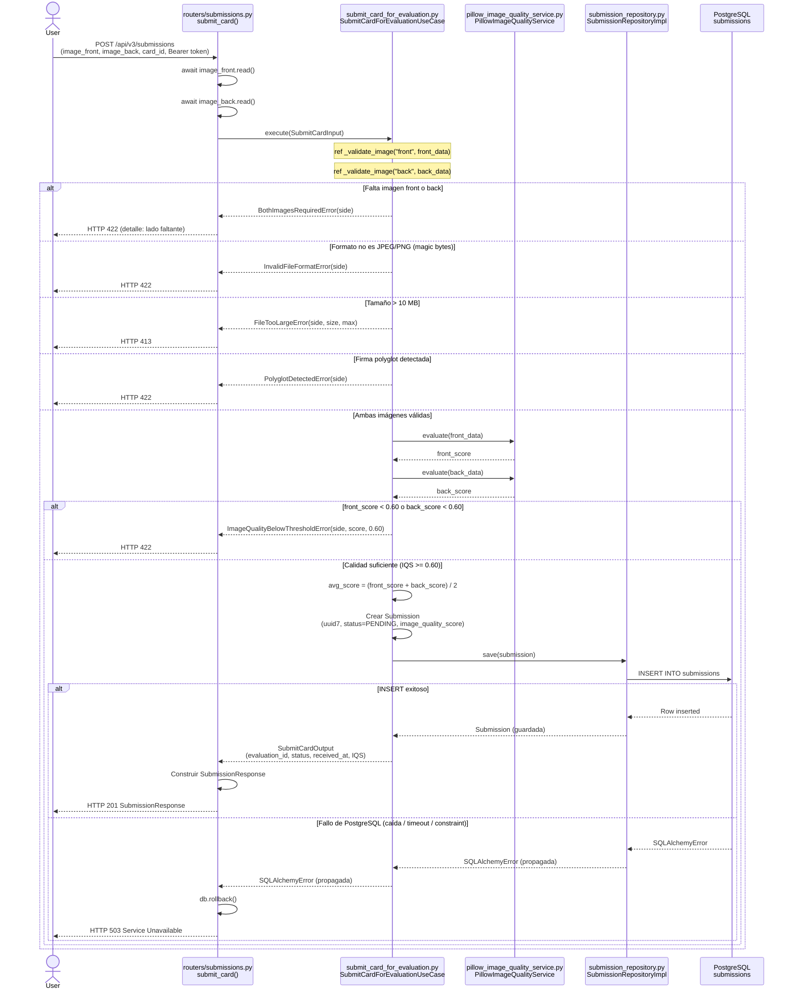
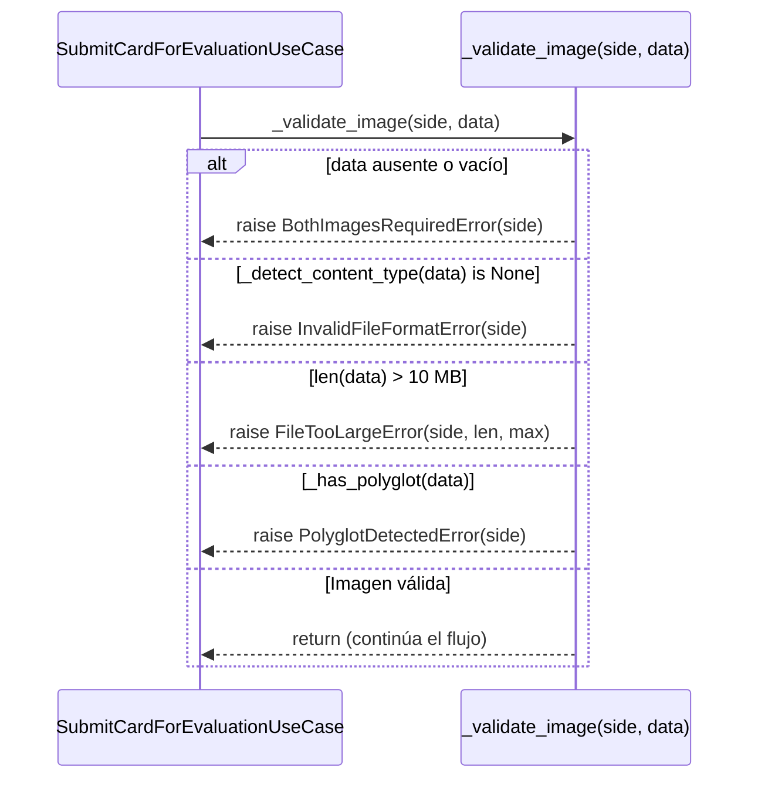

# Diagrama de Secuencia — Enviar Carta para Evaluación (US-003) — Corregido

> Versión corregida del diagrama `DiagramaSecuenciaEvalCarta`. Incorpora **modularidad**
> (la validación de imagen se modela como un procedimiento reutilizable invocado para
> el frente y el reverso) y **rutas de fallo con retorno explícito** para cada caso de
> error: imagen faltante, formato inválido, tamaño excedido, polyglot, calidad baja y
> **fallo de persistencia en PostgreSQL**.

---

## 1. Cambios respecto al diagrama original

| # | Problema en el diagrama original | Corrección aplicada |
|---|---|---|
| 1 | Solo mostraba el camino feliz (HTTP 201). | Se agregan fragmentos `alt` con el retorno de cada error. |
| 2 | La validación se dibujaba inline dos veces (frente y reverso). | Se extrae a un procedimiento reutilizable `_validate_image(side, data)` invocado 2 veces (`ref`). |
| 3 | No contemplaba el fallo de PostgreSQL. | Se agrega el fragmento `alt [fallo de BD]` → `db.rollback()` → **HTTP 503**. |
| 4 | "Solo front" / "solo back" no estaban representados. | Ambos caen en `BothImagesRequiredError` → **HTTP 422**, indicando el lado faltante. |

> **Nota de implementación:** el caso de fallo de PostgreSQL ahora está manejado en el
> código real. Ver [`routers/submissions.py`](../../src/pokegrading/api/v3/routers/submissions.py)
> (`except SQLAlchemyError` → `db.rollback()` → 503).

---

## 2. Diagrama principal (Mermaid)

---

## 3. Subdiagrama reutilizable — `_validate_image(side, data)`

Procedimiento invocado dos veces (frente y reverso) desde el caso de uso. Modela la
modularidad: una sola definición de la lógica de validación reutilizada por ambos lados.

---

## 4. Matriz del diagrama (camino feliz + fallos)

| Paso del diagrama | Criterio de aceptación relacionado | Componente de arquitectura lógica |
| --- | --- | --- |
| Usuario envía solicitud para evaluar una carta | US — Enviar carta para evaluación | Frontend / Interfaz de usuario |
| Frontend envía `POST /api/v3/submissions` con `image_front`, `image_back`, `card_id` | La evaluación requiere imagen frontal, trasera e id de carta | API PokéGrading / `routers/submissions.py - submit_card()` |
| API recibe el Bearer token | La solicitud debe estar asociada a un usuario autenticado | API PokéGrading / Capa de autenticación |
| API lee los archivos de imagen como bytes | Las imágenes deben cargarse como bytes antes de procesarse | API PokéGrading / Endpoint de submissions |
| API construye `SubmitCardInput` | Separación por capas; el endpoint prepara la entrada | API PokéGrading / DTO de entrada |
| API delega a `SubmitCardForEvaluationUseCase` | La lógica de evaluación vive en la capa de aplicación | Caso de uso `SubmitCardForEvaluationUseCase` |
| Se valida la imagen frontal (`ref _validate_image`) | La imagen frontal debe existir, tener formato válido y pasar seguridad | Validación reutilizable / Caso de uso |
| Se valida la imagen trasera (`ref _validate_image`) | La imagen trasera cumple las mismas reglas que la frontal | Validación reutilizable / Caso de uso |
| **Fallo: falta imagen front o back → `BothImagesRequiredError`** | **El sistema rechaza envíos incompletos indicando el lado faltante → HTTP 422** | **Caso de uso / Validación** |
| **Fallo: formato no JPEG/PNG → `InvalidFileFormatError`** | **Solo se aceptan formatos inspeccionables → HTTP 422** | **Validación de entrada / Seguridad** |
| **Fallo: tamaño > 10 MB → `FileTooLargeError`** | **Se rechazan archivos demasiado grandes → HTTP 413** | **Validación de entrada / Seguridad** |
| **Fallo: firma polyglot → `PolyglotDetectedError`** | **Se bloquean archivos maliciosos camuflados como imagen → HTTP 422** | **Validación de seguridad / Caso de uso** |
| Se evalúa la calidad de la imagen frontal | El sistema calcula una métrica de calidad antes de registrar | `PillowImageQualityService` |
| Se evalúa la calidad de la imagen trasera | Ambas caras participan en la calidad final | `PillowImageQualityService` |
| **Fallo: IQS < 0.60 → `ImageQualityBelowThresholdError`** | **Imágenes ilegibles no se registran → HTTP 422** | **Caso de uso / Servicio de calidad** |
| Se calcula `avg_score = (front + back) / 2` | El envío almacena un puntaje general basado en ambas imágenes | Caso de uso / Regla de cálculo |
| Se crea la entidad `Submission` (`status=PENDING`) | La carta queda registrada como solicitud pendiente | Entidad de dominio / Submission |
| Se guarda la submission (`save`) | La solicitud debe persistirse en el sistema | Repositorio / `SubmissionRepositoryImpl` |
| El repositorio ejecuta `INSERT` en PostgreSQL | El diagrama lógico incluye el almacén persistente | PostgreSQL / Tabla `submissions` |
| **Fallo: error de PostgreSQL → `SQLAlchemyError`** | **Un fallo de BD revierte la transacción (`rollback`) y no deja estado inconsistente → HTTP 503** | **Repositorio / PostgreSQL / Router** |
| Se retorna `SubmitCardOutput` | El caso de uso devuelve id de evaluación, estado y fecha | Caso de uso / Salida de aplicación |
| API construye `SubmissionResponse` | La API adapta la respuesta interna al formato HTTP | API PokéGrading / `routers/submissions.py` |
| API responde `HTTP 201` | Resultado exitoso de creación de la solicitud | API PokéGrading / Frontend |

---

## 5. Resumen de códigos HTTP

| Resultado | Excepción | HTTP | Origen |
| --- | --- | --- | --- |
| Éxito | — | **201 Created** | Router |
| Imagen front o back ausente | `BothImagesRequiredError` | **422** | Use case |
| Formato no JPEG/PNG | `InvalidFileFormatError` | **422** | Use case |
| Tamaño > 10 MB | `FileTooLargeError` | **413** | Use case |
| Firma polyglot | `PolyglotDetectedError` | **422** | Use case |
| Calidad IQS < 0.60 | `ImageQualityBelowThresholdError` | **422** | Use case |
| Fallo de persistencia | `SQLAlchemyError` | **503** | Router (`db.rollback()`) |
